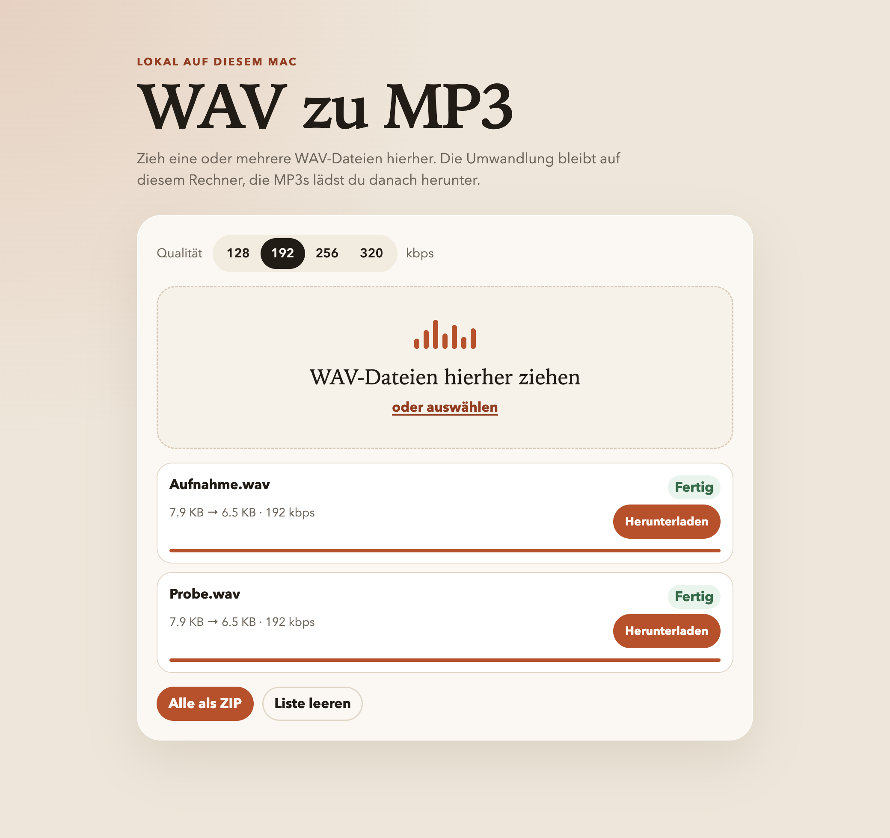

# wav-to-mp3

wav-to-mp3 turns WAV files into MP3s on this computer. A recording, a bounce, or a voice memo often arrives as WAV. This page makes an MP3 you can send or drop into a set, without uploading the audio anywhere.

Drop the files, pick a bitrate, and download one MP3 or the whole batch as a ZIP. ffmpeg encodes with LAME. The browser only talks to a small server on this Mac, and that server only listens on localhost.

[Donate via GitHub Sponsors](https://github.com/sponsors/ChrisEdS)



The page is in German.

## Run

Install [ffmpeg](https://ffmpeg.org/) with the LAME encoder, then start the page:

```bash
brew install ffmpeg
npm start
```

The app opens `http://127.0.0.1:3847`. Node 20 or newer is required.

Set `PORT` to use another port. Set `OPEN=0` to start without opening the browser.

## What happens

1. Drop `.wav` files on the page, or choose them. Anything that is not a WAV is refused.
2. The page sends one file at a time to the local server.
3. ffmpeg writes an MP3 at the bitrate you picked and keeps tags that were already in the WAV.
4. The row turns green. **Herunterladen** saves that MP3. **Alle als ZIP** packs every finished file into `mp3s.zip`.

192 kbps is the default and is enough for most listening. 320 keeps more of the original. 128 makes the smallest file.

**Liste leeren** removes every row and cancels a conversion that is still running. It does not delete an MP3 you already saved.

A file larger than 500 MB is refused. A name that appears twice in one ZIP gets a suffix, so the second `Ton.wav` becomes `Ton (2).mp3`.
