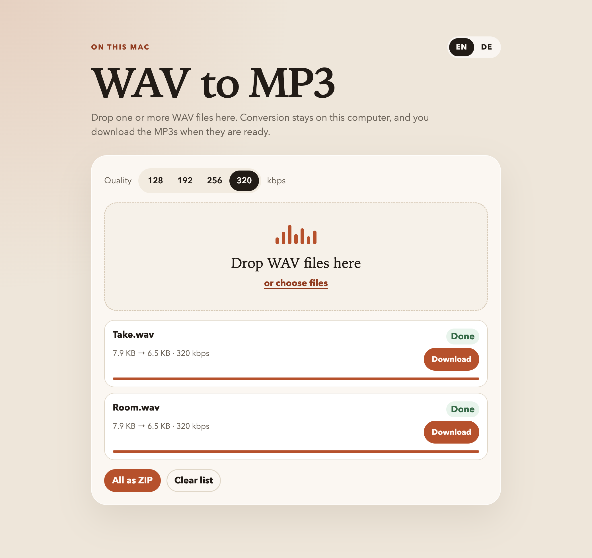

# wav-to-mp3

wav-to-mp3 is a local app that turns WAV files into MP3s. A recording, a bounce, or a voice memo often arrives as WAV. This page makes an MP3 you can send or drop into a set, without uploading the audio anywhere.

Drop the files, pick a bitrate, and download one MP3 or the whole batch as a ZIP. ffmpeg encodes with LAME. The page talks only to a small server on this computer, and that server listens on localhost.

[Donate via GitHub Sponsors](https://github.com/sponsors/ChrisEdS)



English is the default. Use **DE** in the header to switch to German. That choice is stored locally.

## Web

Node 20 or newer, and system [ffmpeg](https://ffmpeg.org/) with LAME:

```bash
brew install ffmpeg
npm start
```

The page opens at `http://127.0.0.1:3847`.

Set `PORT` to use another port. Set `OPEN=0` to start without opening the browser.

## Desktop

The desktop app is the same page and the same conversion server, opened in an Electron window. It listens only on `127.0.0.1`, on a free port. Temporary files stay in the system temp directory. The language choice stays in the app user-data directory. The window does not load remote pages.

ffmpeg 6.1.1 with LAME is downloaded by `npm run fetch-ffmpeg` / `predev` and shipped beside the app. See [THIRD-PARTY-NOTICES.md](THIRD-PARTY-NOTICES.md). It is not linked into the JavaScript.

```bash
npm install
npm run dev
```

`npm run dev` runs that download, then opens the window.

Packaging is local. A git push does not build or publish the desktop app. There is no GitHub Action for it.

```bash
npm run dist:mac
npm run dist:win
npm run dist:linux
```

`npm run dist` builds all three into `release/`.

```bash
GH_TOKEN=... npm run dist:publish
```

That publishes a GitHub Release the installed app can see as an update.

macOS and Windows builds are unsigned. Gatekeeper and SmartScreen warn until the app is signed and, on macOS, notarized. Auto-update on macOS needs a signed zip. There is no Windows ARM ffmpeg, so the Windows build is x64. Linux packages are x64 and arm64. This Mac cannot execute the Windows or Linux binaries.

### Manual checks

- The window opens in English, **DE** switches the page, and the choice survives a restart.
- Drop a WAV. The row reaches Done at 320 kbps, and Download saves an MP3.
- Drop two WAVs and use All as ZIP. Duplicate names get a suffix.
- Drop a non-WAV. The row shows an error and nothing is encoded.
- Clear list removes rows and cancels a running encode.
- Quit the app. No `ffmpeg` process is left behind.
- With ffmpeg removed from the app resources, startup shows an error instead of an empty window.
- An installed build finds an update only when a newer GitHub Release exists.

`npm run smoke` checks one conversion through the local server. It uses `FFMPEG_PATH` or `ffmpeg` on the PATH. It does not launch the window.

## What happens

1. Drop `.wav` files on the page, or choose them. Anything that is not a WAV is refused.
2. The page sends one file at a time to the local server.
3. ffmpeg writes an MP3 at the bitrate you picked and keeps tags that were already in the WAV.
4. The row turns green. **Download** saves that MP3. **All as ZIP** packs every finished file into `mp3s.zip`.

320 kbps is the default and keeps the most of the original. 192 is enough for most listening. 128 makes the smallest file.

**Clear list** removes every row and cancels a conversion that is still running. It does not delete an MP3 you already saved.

A file larger than 500 MB is refused. A name that appears twice in one ZIP gets a suffix, so the second `Ton.wav` becomes `Ton (2).mp3`.
